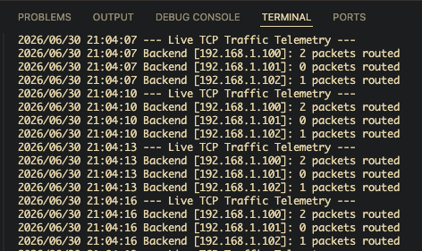
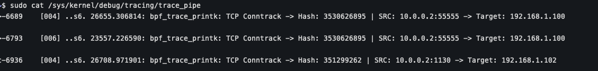

# XDP-LB: High-Performance Layer 4 Load Balancer

This is a from-scratch, kernel-level Layer 4 load balancer built to explore how hyperscale network systems route millions of packets per second. By leveraging **eBPF** and **XDP (eXpress Data Path)**, this project drops the heavy overhead of the standard Linux networking stack, intercepting and routing packets directly inside the Network Interface Card (NIC) driver.

> **Status: work in progress.** Today the program parses, hashes and counts every IPv4 TCP packet on the interface, then passes it to the local stack unchanged. **It does not forward traffic to backends yet.** Forwarding, real consistent hashing, health checks and metrics are being added phase by phase; see the [roadmap](docs/README.md) and the per-phase notes in [`docs/`](docs/).

## Architecture
The system is divided into two distinct decoupled layers:

* **The Data Plane (C):** A C program compiled to eBPF bytecode. It runs in the kernel, parsing raw Ethernet/IP/TCP memory structures, calculates hash on the network 5-tuple, and looking up routing decisions in $O(1)$ time.
* **The Control Plane (Go):** A user-space daemon built with `cilium/ebpf`. It autonomously detects active network interfaces, loads configurations, and orchestrates the kernel via shared eBPF Maps.

## ✨ What Works Today
* **Flow-stable backend selection:** Hashes the 5-Tuple (Src IP, Dst IP, Src Port, Dst Port, Protocol) onto a 251-slot ring, so every packet of a TCP connection selects the same backend. The ring is currently filled with `slot % backends`; Maglev consistent hashing replaces it in phase 3.
* **Kernel-Space to User-Space Telemetry:** Per-backend packet counters are kept in kernel memory and polled asynchronously by Go.
* **Validated configuration:** Reads backend pools from JSON and reports every problem in the file at once (invalid, duplicate or non-IPv4 addresses, unknown keys, missing interface) before touching the kernel.
* **Zero-cost debug tracing:** Per-packet tracing is compiled in but removed by the verifier unless you start with `-debug`.

## Requirements
* Linux **5.9+** (XDP attach via `bpf_link`). `-debug` tracing needs **5.16+**.
* Go **1.24+**, clang/LLVM, libbpf headers.
* Root, or `CAP_BPF` + `CAP_NET_ADMIN`.

## Configuration
```json
{
    "interface": "veth-host",
    "backends": ["192.168.1.100", "192.168.1.101", "192.168.1.102"]
}
```
| Key | Meaning |
| --- | --- |
| `interface` | Interface to attach to. `"auto"` (or empty) picks the interface that carries the default route, which is usually your primary NIC, so prefer an explicit name. |
| `backends` | 1 to 10 unique IPv4 addresses. |

| Flag | Default | Meaning |
| --- | --- | --- |
| `-config` | `config.json` | Path to the configuration file. |
| `-debug` | off | Trace every packet to the kernel trace pipe. Roughly 20x slower per packet; never use under load. |

## How to Run and Test

### 1. Prerequisites
You need a Linux environment with the eBPF toolchain installed:
```bash
sudo apt update
sudo apt install -y clang llvm libbpf-dev linux-headers-generic iproute2 netcat-openbsd
```
You also need Go 1.24 or newer.

### 2. Build the Project
The Makefile automatically generates the Go bindings from the C code and compiles the engine.
```bash
make clean && make
```

### 3. Setup the Testbed
To test ingress XDP safely without killing your main internet connection, create a virtual ethernet (veth) cable and a network namespace:
```bash
sudo ip link add veth-host type veth peer name veth-guest
sudo ip netns add xdp-test
sudo ip link set veth-guest netns xdp-test
sudo ip addr add 10.0.0.1/24 dev veth-host
sudo ip link set veth-host up
sudo ip netns exec xdp-test ip addr add 10.0.0.2/24 dev veth-guest
sudo ip netns exec xdp-test ip link set veth-guest up
sudo ip netns exec xdp-test ip link set lo up
```

### 4. Execute
Make sure your `config.json` interface is set to `veth-host`.
Run the Go daemon (Terminal 1). `-debug` turns on the per-packet trace used in the next step:
```bash
sudo ./xdp-lb -config config.json -debug
```



Watch the kernel trace logs (Terminal 2):
```bash
sudo cat /sys/kernel/debug/tracing/trace_pipe
```



### 5. Check TCP Stickiness
Fire traffic from the namespace (Terminal 3). The same source port always selects the same backend in the trace. Nothing listens on port 80, so `nc` reports "connection refused"; the SYN is still hashed and counted.
```bash
# Simulating Client A (Should consistently select Backend X)
sudo ip netns exec xdp-test nc -p 55555 -zv 10.0.0.1 80

# Simulating Client B (Should consistently select Backend Y)
sudo ip netns exec xdp-test nc -p 44444 -zv 10.0.0.1 80
```

### 6. Tear Down
Stop the daemon with Ctrl-C (this detaches the XDP program), then remove the testbed:
```bash
sudo ip netns del xdp-test
sudo ip link del veth-host
```

### Run the Tests
```bash
make test
```

## Roadmap
The plan, the status of each phase and the concepts and decisions behind every change live in [`docs/`](docs/README.md).

| Phase | Goal |
| --- | --- |
| 0. Clean up | Honest README, strict build, validated config, tracing off by default |
| 1. Safety net | Packet-level tests, per-packet benchmarks, CI |
| 2. Balance for real | Virtual services and packet forwarding (`XDP_TX`) |
| 3. Balance well | Maglev hashing, connection table, health checks, live reload |
| 4. Operate it | Per-CPU metrics, hitless restart, packaging |
| 5. Extend | IPIP, IPv6, UDP, VLAN, published benchmarks |

## Author
**Mohd Rashid** - [@mohdrashid9678](https://github.com/mohdrashid9678)

## Contributing
Contributions are always welcome. Create an issue, then raise a PR against it.
